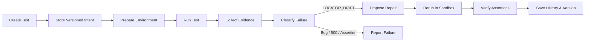

# HealTest — Adaptive Self-Healing E2E Testing Platform

> **Intent-aware self-healing test automation backend**: Runs E2E tests against isolated applications, diagnoses failures using multi-modal browser & network runtime evidence, safely proposes minimal repairs for UI/locator drift without ever weakening test assertions, and verifies fixes before activation.

[](https://fastapi.tiangolo.com)
[](https://www.python.org/)
[](https://playwright.dev/)
[]()
[](https://humans-hackwave3-0.vercel.app)

---

## 🌐 Live Deployed Backend

- **Base URL**: [`https://humans-hackwave3-0.vercel.app`](https://humans-hackwave3-0.vercel.app)
- **Interactive Swagger Documentation**: [`https://humans-hackwave3-0.vercel.app/docs`](https://humans-hackwave3-0.vercel.app/docs)
- **Alternative ReDoc UI**: [`https://humans-hackwave3-0.vercel.app/redoc`](https://humans-hackwave3-0.vercel.app/redoc)
- **Health Check & Readiness**: [`https://humans-hackwave3-0.vercel.app/health`](https://humans-hackwave3-0.vercel.app/health)
- **OpenAPI 3.1.0 Schema**: [`https://humans-hackwave3-0.vercel.app/openapi.json`](https://humans-hackwave3-0.vercel.app/openapi.json)

---

## 🎯 MVP Goal & Core Principles

Traditional self-healing testing platforms often make brittle tests pass by weakening assertions, deleting checks, or applying dangerous arbitrary code patches. **HealTest enforces strict integrity**:

1. **Immutable Intent**: Original natural-language intent and required business assertions are **write-once and immutable**.
2. **Minimal Repairs Only**: The system only ever updates the smallest necessary locator/action mapping when evidence confirms the control still exists (`LOCATOR_DRIFT`).
3. **No False Healing**: 5xx server errors, broken API contracts, or unmet business outcomes are **never healed** — they are diagnosed, categorized, and flagged for human review.
4. **Verified Reruns**: Any proposed repair must pass a complete re-run verifying all original assertions before it can be explicitly approved.

### Core Lifecycle Flow



---

## 🛠️ Tool Limits & Technology Stack

The platform adheres to four strictly scoped external analysis and execution tools:

| Tool | Purpose in System |
|---|---|
| **Playwright** | Browser execution, DOM/locator inspection, screenshots, traces, console & network evidence. |
| **Tree-sitter** | Syntax-aware repository inspection, AST indexing of routes, components, and handlers without execution. |
| **E2B Sandbox** | Disposable cloud sandboxes for isolated repository builds, app startup, and test runs under resource limits. |
| **Groq API** | LLM classification for ambiguous signals, natural-language failure explanations, and structured repair JSON. |
| **Supabase** | Persistence layer: Auth, Postgres relational metadata, and private Storage buckets for evidence artifacts. |

---

## 📊 Failure Classification Taxonomy

All failures are classified using a deterministic-first engine with strict enum outputs:

| Category | Description | Auto-Heal Eligible? |
|---|---|:---:|
| `LOCATOR_DRIFT` | Target element renamed, restyled, or moved, but the intended control exists. | ✅ Yes (propose repair) |
| `UI_FUNCTIONAL_REGRESSION` | Interaction succeeded but user-visible behavior is absent or incorrect. | ❌ No (report bug) |
| `API_FAILURE` | An HTTP request failed or returned 5xx / unexpected error status. | ❌ No (report bug) |
| `CONTRACT_MISMATCH` | Observed API response schema violates required business contract. | ❌ No (report bug) |
| `ASSERTION_FAILURE` | Core business requirement not met (e.g., missing confirmation message). | ❌ No (report bug) |
| `ENVIRONMENT_FAILURE` | App failed to start, dependency error, sandbox timeout, or infrastructure issue. | ❌ No (infra alert) |
| `AMBIGUOUS_REQUIRES_REVIEW`| Evidence is contradictory or confidence score is below threshold. | ❌ No (human review) |

---

## 📡 API Reference

### 1. Projects
- `GET /projects` — List all projects owned by caller
- `POST /projects` — Create project metadata
- `GET /projects/{project_id}` — Get project metadata
- `POST /projects/{project_id}/repository` — Upload repository ZIP for safe Tree-sitter inspection & hashing

### 2. Tests
- `GET /projects/{project_id}/tests` — List all test definitions under a project
- `POST /projects/{project_id}/tests` — Create test intent, required assertions, and initial action plan
- `GET /tests/{test_id}` — Get test definition, current version, and latest status

### 3. Runs & Orchestration
- `POST /tests/{test_id}/runs` — Execute automated test run (spins sandbox, runs browser, collects evidence, classifies)
- `GET /runs/{run_id}` — Get run status, classification, confidence, and verdict
- `GET /tests/{test_id}/runs` — Get run history for a test
- `GET /runs/{run_id}/artifacts` — List evidence artifacts (screenshots, traces, DOM) with signed URLs
- `POST /runs/{run_id}/transition` — Manually advance state machine (for testing/custom pipelines)

### 4. Repairs
- `GET /runs/{run_id}/repair-proposals` — List repair proposals for a run
- `POST /runs/{run_id}/repair-proposals` — Propose candidate plan
- `GET /repair-proposals/{proposal_id}` — Get specific repair proposal details
- `POST /runs/{run_id}/repair-proposals/{proposal_id}/validate` — Re-execute candidate repair in sandbox
- `POST /repair-proposals/{proposal_id}/approve` — Approve verified repair and promote to active version

---

## 🧪 Testing & Verification

The test suite covers domain logic, persistence contracts, state machines, browser runners, and API endpoints:

```bash
# Run complete test suite (313+ tests)
python -m pytest

# Run demo scenarios (Revision A: Pass, Revision B: Locator Drift Healed, Revision C: API 500 Not Healed)
python -m pytest tests/demo_full_flow.py -v -s

# Run deployment smoke test against local or remote instance
python scripts/smoke_test.py --url https://humans-hackwave3-0.vercel.app
```

---

## 🚀 Local Setup & Deployment

### Local Development
```bash
# 1. Clone repository
git clone https://github.com/HeadTarun/Humans-Hackwave3.0.git
cd Humans-Hackwave3.0/app

# 2. Setup virtual environment
python -m venv .venv
source .venv/bin/activate  # Or on Windows: .venv\Scripts\activate

# 3. Install dependencies & browsers
pip install -r requirements.txt
python -m playwright install chromium

# 4. Configure environment
cp .env.example .env

# 5. Run the server
python run.py
```

### Docker Deployment
```bash
docker build -t healtest-backend .
docker run -p 8000:8000 --env-file .env healtest-backend
```

---

## 👥 Authors & Hackathon Team

Built for **Humans Hackwave 3.0** by Team **Humans**.
